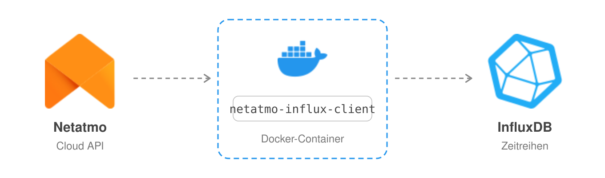

# netatmo-client-influx


Reads your Netatmo Weather Station through the Netatmo API and writes every reading
to **InfluxDB 1.x**.





Netatmo Weather Station dashboard for Grafana


This is a fork of [karaktaka/netatmo-client-influx](https://github.com/karaktaka/netatmo-client-influx),
which targets InfluxDB 2.x. This fork writes to InfluxDB 1.x through the `influxdb` Python client instead.

## How it works

The client runs as a long-lived process. Every `interval` seconds it

1. refreshes the OAuth2 access token when needed (stored in a token file),
2. calls `getstationsdata` for all stations of your account,
3. writes one point per sensor value to InfluxDB.

## Prerequisites

- Python 3.12 and [uv](https://docs.astral.sh/uv/), or Docker

- InfluxDB 1.x with a database for the data, e.g.

  ```bash
  influx -execute 'CREATE DATABASE netatmo'
  ```

- A Netatmo app and a refresh token:

  1. Create an app at <https://dev.netatmo.com/apps>.
  2. In the app, scroll to **Token generator** and generate a token with the scope `read_station`.
  3. Note the client ID, the client secret and the **refresh token**.

## Configuration

Settings come from a YAML file, from environment variables, or both. Environment variables win.

### config.yaml

Copy `src/config.yaml.template` to `src/config.yaml` and fill it in:

```yaml
interval: 600          # seconds between two runs
loglevel: "INFO"       # DEBUG, INFO, WARNING, ...

netatmo:
  client_id: "..."
  client_secret: "..."
  refresh_token: "..."  # only needed for the first start, see "Token file"

influx:
  influx_host: "localhost"
  influx_port: "8086"
  influx_db: "netatmo"
  influx_ssl: ""
  influx_username: "user"
  influx_password: "pass"
```

By default the file is read from next to `client.py`. Use `-c /path/to/config.yaml` to point elsewhere.

### Environment variables

| Variable                | Config key               | Default     |
| ----------------------- | ------------------------ | ----------- |
| `INTERVAL`              | `interval`               | `300`       |
| `LOGLEVEL`              | `loglevel`               | `INFO`      |
| `NETATMO_CLIENT_ID`     | `netatmo.client_id`      |             |
| `NETATMO_CLIENT_SECRET` | `netatmo.client_secret`  |             |
| `NETATMO_REFRESH_TOKEN` | `netatmo.refresh_token`  |             |
| `INFLUX_HOST`           | `influx.influx_host`     | `localhost` |
| `INFLUX_PORT`           | `influx.influx_port`     | `8086`      |
| `INFLUX_DB`             | `influx.influx_db`       | `netatmo`   |
| `INFLUX_SSL`            | `influx.influx_ssl`      | see below   |
| `INFLUX_USERNAME`       | `influx.influx_username` | `user`      |
| `INFLUX_PASSWORD`       | `influx.influx_password` | `pass`      |

The InfluxDB defaults only apply when an `influx:` section exists in the config file.
When you configure everything through environment variables, set all `INFLUX_*` variables.

**SSL:** the connection is currently always plain HTTP. `influx_ssl` is passed on as a string, and the
`influxdb` client only switches to HTTPS for a real boolean `True`.

### Command line

| Option                | Meaning                                                   |
| --------------------- | --------------------------------------------------------- |
| `-c`, `--config-file` | path to the config file                                   |
| `-t`, `--token-file`  | path to the token file, default `data/token.json`         |
| `-v`, `-vv`, `-vvv`   | log level WARNING, INFO, DEBUG (overridden by `LOGLEVEL`) |

### Token file

Netatmo rotates the refresh token. The client therefore stores the current access token,
refresh token and expiry time in a token file (default `data/token.json`, relative to the working
directory) and prefers it over the configured refresh token.

- The directory must exist and be writable by the user running the client.
- The refresh token from the config is only used while no token file exists.
- If the token file is lost and the configured refresh token is outdated, generate a new one in the
  Netatmo developer console.

## Running

### With uv

```bash
uv sync
mkdir -p data
uv run src/client.py
```

### With Docker

The CI publishes an image to `ghcr.io/hb9uqs/netatmo-client-influx` (`latest` from `main`, plus a tag for
each version tag). A complete setup with InfluxDB 1.x:

```yaml
services:
  influxdb:
    image: docker.io/influxdb:1.11-alpine
    restart: unless-stopped
    environment:
      - INFLUXDB_DB=netatmo
      - INFLUXDB_HTTP_AUTH_ENABLED=true
      - INFLUXDB_ADMIN_USER=admin
      - INFLUXDB_ADMIN_PASSWORD=change-me
      - INFLUXDB_USER=netatmo
      - INFLUXDB_USER_PASSWORD=change-me-too
    volumes:
      - influxdb:/var/lib/influxdb

  netatmo-client-influx:
    image: ghcr.io/hb9uqs/netatmo-client-influx:latest
    restart: unless-stopped
    environment:
      - INTERVAL=600
      - NETATMO_CLIENT_ID=...
      - NETATMO_CLIENT_SECRET=...
      - NETATMO_REFRESH_TOKEN=...
      - INFLUX_HOST=influxdb
      - INFLUX_PORT=8086
      - INFLUX_DB=netatmo
      - INFLUX_USERNAME=netatmo
      - INFLUX_PASSWORD=change-me-too
    volumes:
      - ./data:/app/data
    depends_on:
      - influxdb

volumes:
  influxdb:
```

The container runs as UID `10001`. Make sure `./data` is writable for it, e.g.
`mkdir data && sudo chown 10001 data`, otherwise the token file cannot be saved.

`docker-compose-dev.yml` builds the image from source for local development.

## Data in InfluxDB

Every value becomes its own measurement with a single field `value`:

| Measurements                                                 | Tags                                |
| ------------------------------------------------------------ | ----------------------------------- |
| Sensor values: `temperature`, `humidity`, `pressure`, `absolutepressure`, `co2`, `noise`, `rain`, `sum_rain_1`, `sum_rain_24`, `windstrength`, `windangle`, `guststrength`, `gustangle`, `min_temp`, `max_temp`, `max_wind_str`, `temp_trend`, `pressure_trend`, … | `home`, `station`, `module`, `type` |
| Device status: `rf_status` (also the base station's Wi-Fi signal), `battery_percent`, `battery_vp`, `reachable`, `co2_calibrating` | `home`, `station`, `module`, `type` |
| Station location: `altitude`, `latitude`, `longitude`, `country`, `city`, `timezone` | `home`, `station`, `type`           |

Which measurements exist depends on your modules; the client writes whatever the API returns.
Sensor values carry the measurement time reported by Netatmo (second precision); `min_temp`, `max_temp`
and `max_wind_str` are stored at the time the extreme occurred. Station location values are stamped with
the time of the run.

Example query:

```sql
SELECT mean("value") FROM "temperature" WHERE "module" = 'Outdoor' AND time > now() - 24h GROUP BY time(1h)
```

## Grafana dashboard

`dashboard.json` comes from the upstream project. Its queries are written in **Flux** against the bucket
`netatmo`. To use it with InfluxDB 1.x, enable Flux in InfluxDB (`flux-enabled = true` in the `[http]`
section, available from 1.8) and add the InfluxDB datasource in Grafana with the query language set to Flux.
Then import the dashboard and select that datasource.

## Development

- Code style is checked with [ruff](https://docs.astral.sh/ruff/) on every pull request
  (`ruff check` and `ruff format --check`).
- Pushes to `main` and version tags `v*` build and publish the Docker image.

## Credits

Original project by Dennis Bernardy: [karaktaka/netatmo-client-influx](https://github.com/karaktaka/netatmo-client-influx).

